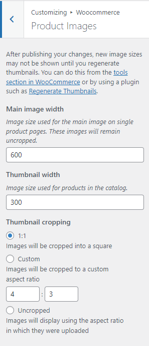

This guide covers installation in 5 steps, from downloading the theme files to importing the demo content. Follow the steps in order. If something goes wrong, check [Troubleshooting](#troubleshooting) at the end.

## Step 1: Download theme

You can install Motta through WordPress or with FTP. Download the theme files from ThemeForest first.

If this is your first download, choose the **All files & documentation** package. It includes the child theme, plugins, demo content, and documentation. If you already have the full package, choose **Installable WordPress file only**.

1. Sign in to your ThemeForest account and open the **Downloads** tab.
2. Find your Motta purchase and click **Download**.
3. Choose **Installable WordPress file only** or **All files & documentation**.

## Step 2: Install theme

Unzip the package you downloaded from ThemeForest. You'll find `motta.zip`, the file you upload to install the theme.

:::tip
If you plan to change the theme, install the parent theme and the child theme, then activate the child theme. A child theme lets you change parts of Motta without touching the parent theme files.
:::

### Install through WordPress

1. Go to **Appearance → Themes**, click **Add New**, then **Upload Theme**.
2. Click **Choose File** and select the file you downloaded. If you downloaded the installable WordPress file, upload it as is. If you downloaded the full package, unzip the main `motta.zip` file first and select the second `motta.zip` inside it.
3. Click **Install Now**.
4. When the upload finishes, click **Activate**. You can also activate **Motta** later from **Appearance → Themes**.

### Install with FTP

Use FTP if the WordPress install fails.

1. If you have the full package, unzip it to get `motta.zip`. Unzip that file to get the `Motta` folder.
2. Use an FTP client such as [FileZilla](https://filezilla-project.org/) to upload the folder to `wp-content/themes` on your host.
3. In WordPress, go to **Appearance → Themes** and click **Activate** under Motta.

## Step 3: Install plugins

After you activate Motta, WordPress shows a notice at the top of the page saying the theme needs plugins.

### Required plugins

Required plugins must stay installed and active for Motta to work. Motta requires:

- [WooCommerce](https://wordpress.org/plugins/woocommerce/): the eCommerce plugin for selling products.
- [Elementor](https://wordpress.org/plugins/elementor/): a page builder for creating layouts. You can use WPBakery Page Builder instead. Don't install both.
- Motta Addons: extra Elementor elements built for Motta.
- [Kirki](https://wordpress.org/plugins/kirki/): creates the theme options in the Customizer. It's free on WordPress.org.
- [Meta Box](https://wordpress.org/plugins/meta-box/): creates meta boxes for posts and pages. It's free on WordPress.org, with premium extensions for custom fields. Use the coupon **TF-MFFCW** for 20% off extensions at [metabox.io](https://metabox.io).

### Recommended plugins

Recommended plugins are the ones we use in our demos and integrate with Motta. You can skip any you don't plan to use. Motta recommends:

- [Contact Form 7](https://wordpress.org/plugins/contact-form-7/): creates contact forms. It's free on WordPress.org.
- [MailChimp for WordPress](https://wordpress.org/plugins/mailchimp-for-wp/): adds subscribers to your MailChimp lists.
- [WCBoost - Variation Swatches](https://wordpress.org/plugins/wcboost-variation-swatches/): shows product variations as color or size swatches.
- [WCBoost - Wishlist](https://wordpress.org/plugins/wcboost-wishlist/): adds wishlist features. It needs WooCommerce installed.
- [WCBoost - Products Compare](https://wordpress.org/plugins/wcboost-products-compare/): adds product comparison. It needs WooCommerce installed.
- [WooCommerce Currency Switcher](https://wordpress.org/plugins/woocommerce-currency-switcher/): lets shoppers switch currencies and see converted rates.

Motta adds styles for these plugins so their design matches the theme.

### Install the plugins

1. Go to **Appearance → Install Plugins**. Motta lists its required and recommended plugins there.
2. Click **Install** under each plugin you want.
3. Activate each plugin after you install it.

## Step 4: Configure image sizes

Set the product image sizes before you import the demo content.

Go to **Appearance → Customize → WooCommerce → Product Images** and set:

- **Main image width**: 600
- **Thumbnail width**: 300
- **Thumbnail cropping**: 1:1

## Step 5: Import demo

Use the [Soo Demo Importer plugin](https://github.com/uixthemeswp/motta/raw/main/plugins/soo-demo-importer.zip) to import demo content. It adds pages, posts, sliders, widgets, menus, theme options, and page assignments. Run the import on a fresh install. It doesn't replace your posts, pages, or portfolio, and it doesn't delete your menus or sliders. It does replace theme options, reading settings, and widgets.

### Before you import

Check each item before you start:

- **Required plugins**: Install Motta's required plugins and the recommended ones too.
- **Motta Addons**: Use the latest version.
- **System status**: Go to **WooCommerce → System Status** and confirm your server meets the requirements.
- **Browser**: Use Chrome or Firefox. Both support the JavaScript APIs the importer uses. Internet Explorer is too old for the importer.

### Import the demo content

1. Download and install the [Soo Demo Importer](https://github.com/uixthemeswp/motta/raw/main/plugins/soo-demo-importer.zip) plugin. You need it to use the **Import Demo Data** feature.
2. Go to **Appearance → Import Demo Data**, choose a demo, and click **Import**.
3. Wait for the import to finish. It can take a few minutes, and the progress log shows what's happening.

## Troubleshooting

If something goes wrong during installation, find your issue below.

### Theme installation

1. **"Are you sure you want to do this?"** error

   You've hit your host's upload size limit. Install the theme with FTP, or ask your host to raise the limit.

1. **Theme is missing the style.css stylesheet** error

   You've uploaded the wrong file. Download either the installable WordPress file or the full package. If you have the full package, unzip it and upload the installable file inside it.

### Plugins

1. **Failed to install or activate a plugin**

   Downloads sometimes fail on some hosts, which leaves files incomplete. Go to **Plugins → Installed Plugins**, delete the affected plugins, then install them again.

### Demo import

1. **I don't see the Import Demo Data menu**

   The **Import Demo Data** feature needs the [Soo Demo Importer](https://github.com/uixthemeswp/motta/raw/main/plugins/soo-demo-importer.zip) plugin. Finish the steps above first.

1. **The import is stuck**

   This usually comes from your hosting setup. Open a ticket at [uix.ticksy.com](https://uix.ticksy.com/) so our developer can check it.

1. **Demo content is duplicated**

   Each click of the import button imports the content again. The import takes a few minutes, so wait for it to finish before you click again. To remove duplicates:
   - **With WP Reset**: Install [WP Reset](https://wordpress.org/plugins/wordpress-reset/). It's the quickest option, but it removes all content from your database and leaves the default theme active. It deactivates plugins and removes pages, posts, menus, sliders, widgets, and theme options. Use this only if you can start over.
   - **Manually**: Delete the duplicate items one by one. Start with **Appearance → Menus**, then do the same for pages, posts, and sliders.

## Next steps

- [Customizer](../theme-options/customizer/) — Set colors, fonts, and layout after the import.
- [Theme support](./support/) — Check what support covers before you open a ticket.
