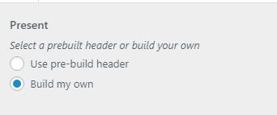
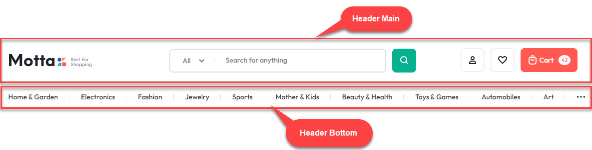
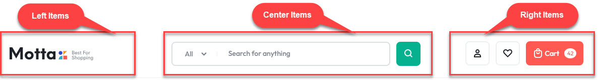
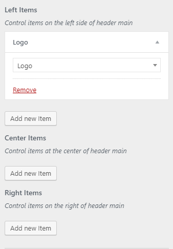

If you don't like one of pre-build header layouts, or sometimes you want to build your own header layout, or just simply add/remove icons on the header. It's the time to try the header builder!

<!-- <iframe width="560" height="500" src="https://www.youtube.com/embed/G3fBwEh97HE" frameborder="0" allow="accelerometer; autoplay; encrypted-media; gyroscope; picture-in-picture" allowfullscreen></iframe> -->

## Activate The Header Builder

By default, Motta uses a [pre-build header layout](../layout/). If you want to activate the header builder, please navigate to Customize > Header > Header Layout and select option **Present** as **Build my own**.

## Header Structure

Before start buiding your own header layout, you should learn about the header structure. It is very easy. Header contains 2 sections, **Header Main** and **Header Bottom**.

Each header section is splited into 3 columns: **Left**, **Center** and **Right**.

You can add items to columns to build your header layout.

## Add Items to Header

After the header builder is activated, you can navigate to the **Header Main** and **Header Bottom** sections to add items to the header. Simply click the button **Add Item** to add a new item to a header column. After that, you can select what item you want to add to the header from the dropdown menu.

Please remember you can re-order items by dragging them in the order you want. At this moment, Motta supports following items:

- [Logo](../logo/)
- [Cart](../cart/)
- [Wishlist](../wishlist/)
- [Compare](../compare/)
- [Logo](../account/)
- [Search](../search/)
- [Primary Menu](../primary-menu/)
- [Secondary Menu](../secondary-menu/)
- [Category Menu](../category-menu/)
- [Hamburger Menu](../hamburger-menu/)
- [Custom Text](../custom-text/)
- [Preferences](../preferences/)
- [View History](../view-history/)
