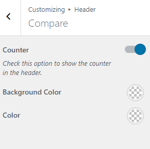
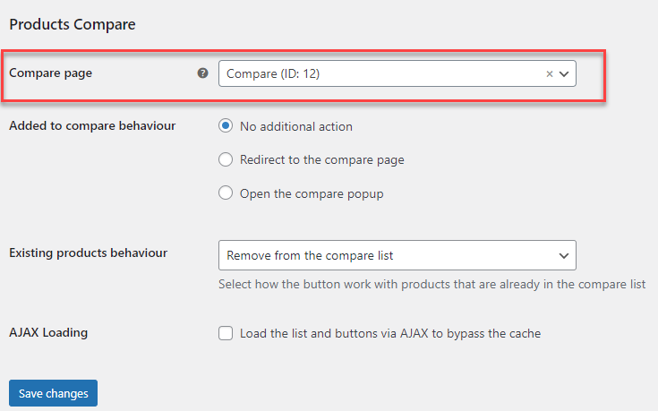

## Compare Options

- **Counter** - To enable/disable the counter of the Compare.
- **Counter Background Color** - To change the background color of the Compare counter
- **Counter Color** - To change the text color of the Compare counter

## Activate Compare

Install and Activate <a href="https://wordpress.org/plugins/wcboost-products-compare/">WCBoost – Compare</a>

## Compare Page

You can show the Compare on any page of your site, different from the one selected by default, by choosing it from **Compare Page** **in WooCommerce > Settings > Products > General > Product Compare** options

