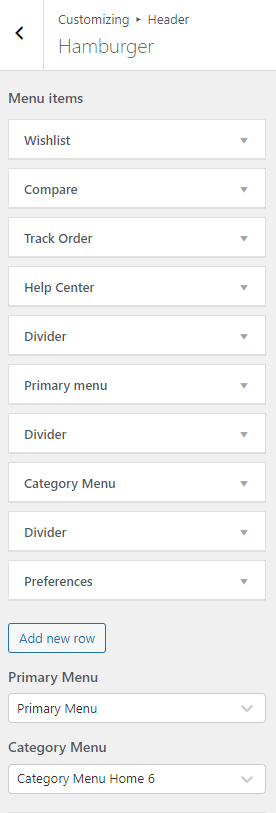

## Hamburger Menu Options

This section provides options for the content that is displayed when the user clicks the hamburger menu icon.

- **Menu Items** - To add/remove/reoder items for the hamburger content
- **Primary Menu** - To change the primary menu for the hamburger. The default is the primary menu location
- **Secondary Menu** - To change the secondary menu for the hamburger. The default is the secondary menu location
- **Track Order** - In the [Track Order Section](../../woocommerce/order-tracking/), you will see more detailed guide to setup your Track Order page
- **Help Center** - In the [Help Center Section](../../woocommerce/order-tracking/), you will see more detailed guide to setup your Help Center page
