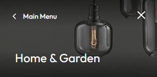
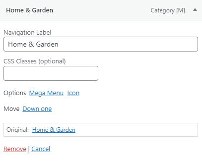
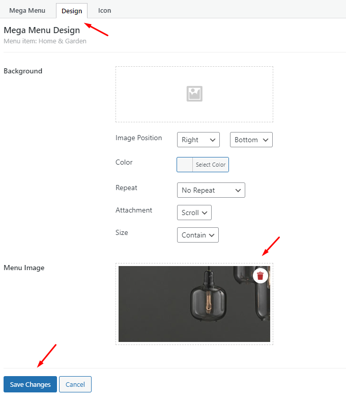

In the **Hamburger Menu** or **Mobile Menu**, there is a header background for each menu. You can change it in the **Menu Image** option of the menu. For product categories, you can add it by adding a background in the **Page Header Background** option.

1. Go to **Home & Garden** and choose **Mega Menu**

1. Switch to the **Design** tab, select **Menu Image**, and enter the image you want.

1. Click **Save Changes** button.
