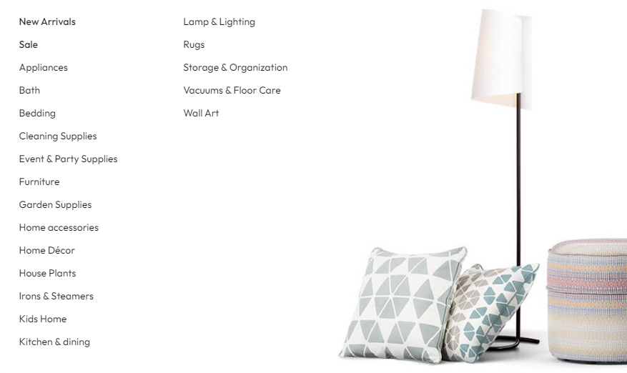
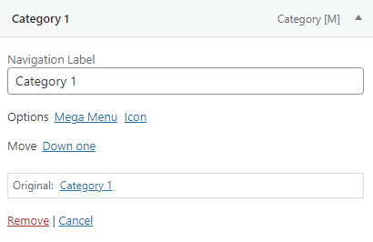
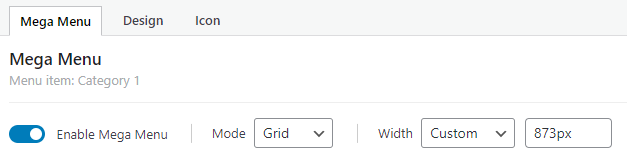
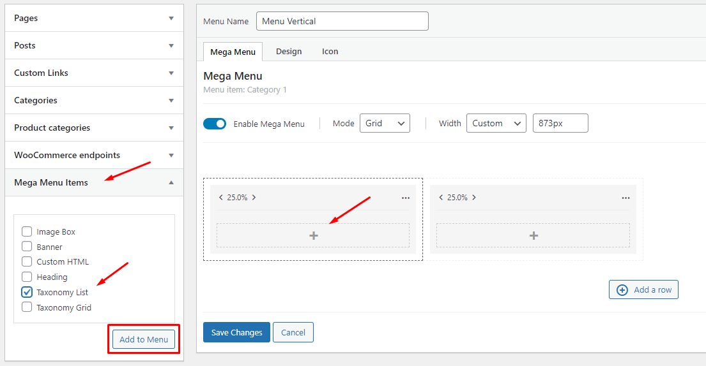
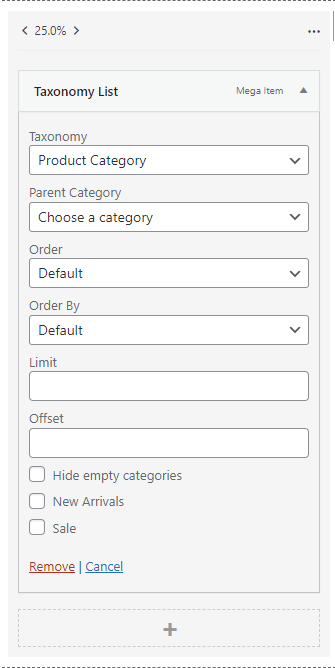
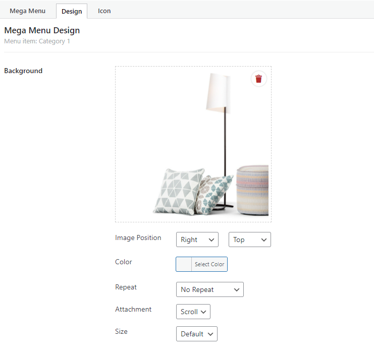

We will take a product category as an example. You can do the same thing in other menus.

1. Go to **Appearance > Menus**
2. Choose **Category Menu** and click **Select** button.
3. Go to **Category 1** and choose **Mega Menu**

1. In the **Mega Menu** tab, select **Enable Mega Menu**.  
2. In the **Mode** option, select **Grid**.  
3. Select **Width** as custom and **873px**.

1. Click on **Add Column** to display 2 columns. Set the width of the two columns to 50% to display the background image in the empty space. 
2. Click on the **"+"** to add a menu item.  
3. In the **Mega Menu item** tab, select **Heading** to add a heading for the column.  
4. Click **Add to Menu**.

Taxonomy List settings

- Taxonomy: Get **Product Category** or **Product Brand**
- Parent Category: Get the categories in the parent category.
- Order: Sort the categories by **Ascending** or **Descending**.
- Order By: Sort the categories by **ID, Title, Menu Order, Product Counts**.
- Limit: The number of categories displayed.
- Offset: The number of categories to be offset.
- Hide empty categories: Hide categories without products.
- New Arrivals: Add a link to the latest product of the category.
- Sale: Add a link to the sale products of the category.

Add similar content from column 1 to column 2. 
Add content similar to other categories.

1. Switch to the Design tab. Add Background and Background Position for Category.

1. Click **Save Changes** button.
