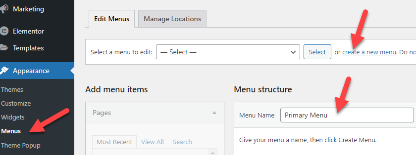
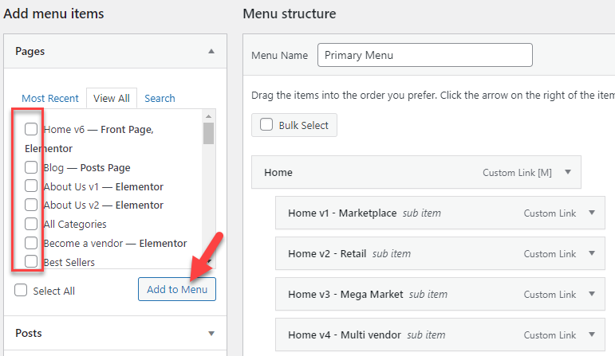
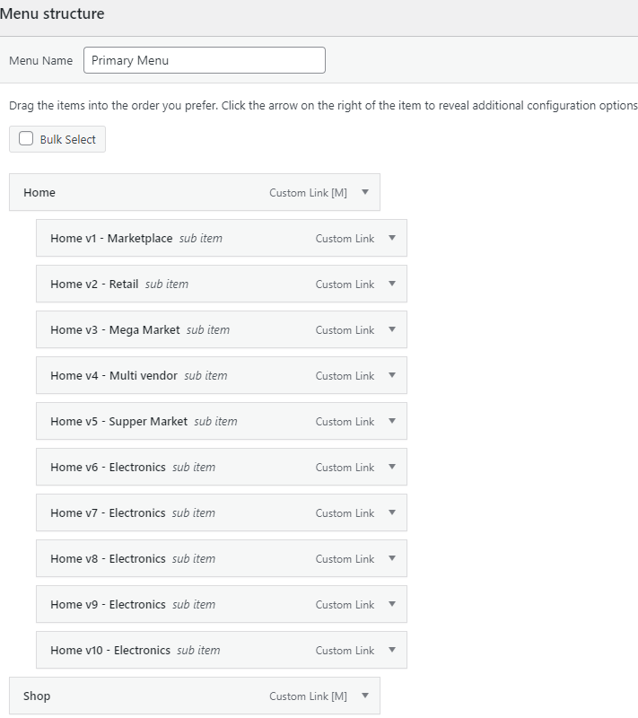
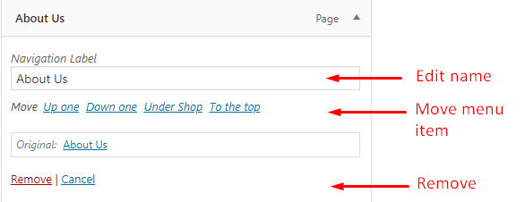
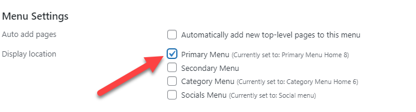
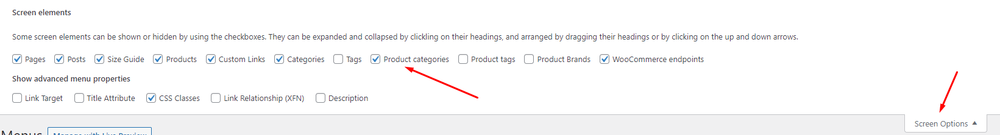
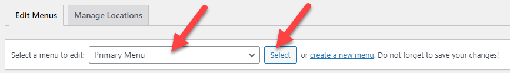

## Create Primary Menu

Menus are the default part of any WordPress site. If you are new with WordPress, we recommend you take a look at this guide firstly – WordPress Menu User Guide. Here is just our brief introduction to menus.

Following these steps to create a menu.

**Step 1** – Go to **Appearance > Menus**

**Step 2** – Click the create a new menu link to create new menu.

**Step 3** – Select items from the left meta boxes and click Add to Menu

**Step 4** – On the right, feel free to drag and drop menu items to organize them.

**Step 5** – You can edit name, move or remove a menu item by click on it.

**Step 6** – When you’re done editting menu items, check primary menu location at the bottom of the page (Optional)

**Step 7** – Click Save Menu

> **Note:**
> By default WordPress only shows the basic menu items, but you can scroll on top page, check sections for menu you want to show. Such as Categories, Custom Links,...

## Edit Primary Menu

Following these steps to edit a menu.

**Step 1** – Go to **Appearance > Menus**

**Step 2** – Click to choose the menu you want to edit from **Select a menu to edit** then click **Select**.

**Step 3** – Select items from the left meta boxes and click Add to Menu (Optional)

**Step 4** – On the right, feel free to drag and drop menu items to organize them.

**Step 5** – You can edit name, move or remove a menu item by click on it.

**Step 6** – When you’re done editting menu items, check primary menu location at the bottom of the page (Optional)

**Step 7** – Click Save Menu

## Mega Menu

In the [Mega Menu Section](../mega-menu-horizontal/#home-menu), you will see more detailed guide to control your mega menu.
