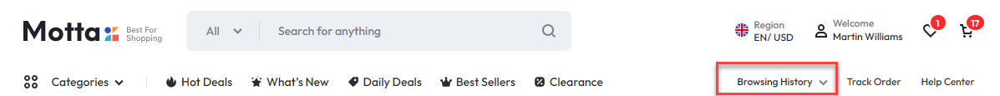
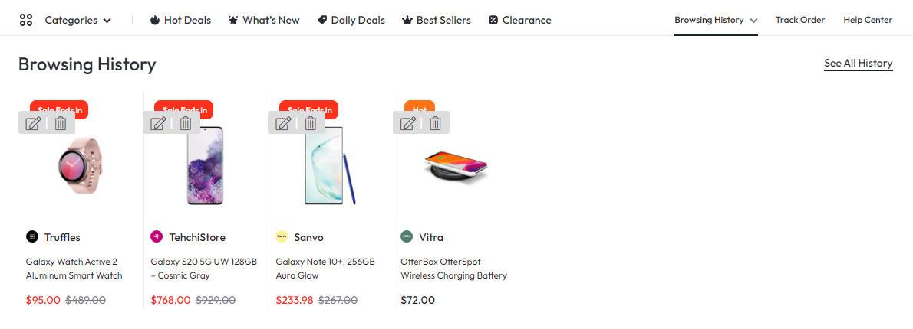

## View History Content

:::note
To change the "See All History" link, go to **Appearance > Customize > Header > View History > Button Link**. In the "Button Link" field, enter the new text for the link.
:::
