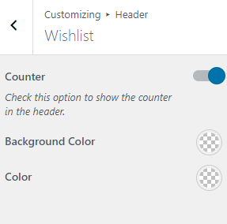
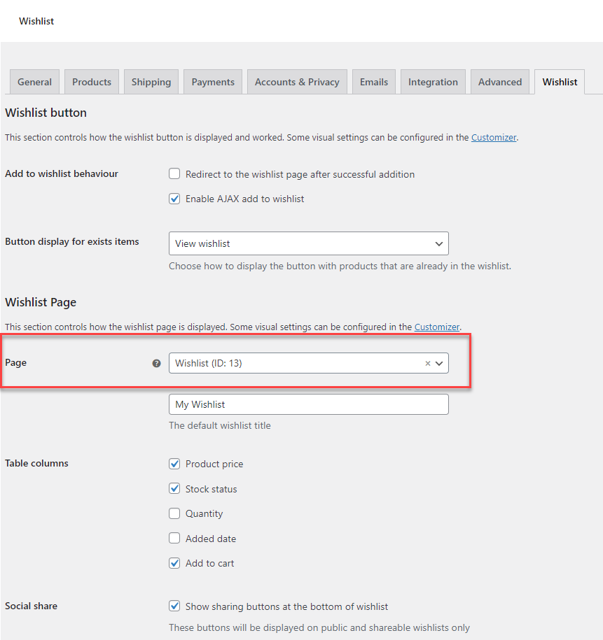

## Wishlist Options

- **Counter** - To enable/disable the counter of the wishlist.
- **Counter Background Color** - To change the background color of the wishlist counter
- **Counter Color** - To change the text color of the wishlist counter

## Activate Wishlist

Install and Activate <a href="https://wordpress.org/plugins/wcboost-wishlist/">WCBoost – Wishlist</a>

## Wishlist Page

You can show the wishlist on any page of your site, different from the one selected by default, by choosing it from **Wishlist Page** **in WooCommerce > Settings > Wishlist** options

