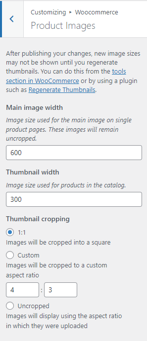

After finish installing required plugins, there some options of product image sizes you must config before importing the demo content.

WooCommerce has settings for image sizes in **Appearance > Customize > WooCommerce > Product Images**.

- **Main image width**: 600
- **Thumbnail width**: 300
- **Thumbnail cropping**: 1:1
