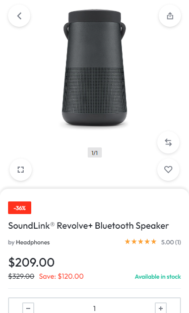

By default, the mobile header of the single product is responsive. Motta supports the mobile header as compact.

To change the mobile header as compact, just go to **Appearance > Customize > Mobile > Single Product**. In **Mobile header** option, select **Compact**
