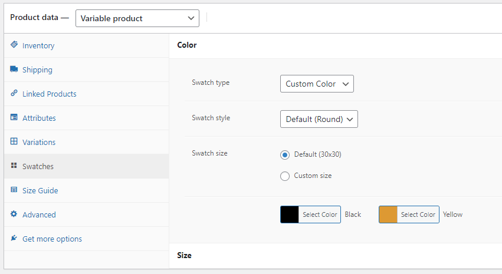

<a href="https://motta.uix.store/product/x509jb-ej018-intel-core-i5-1035g1-4gb-256gb-ssd-mx110/">View Demo</a>

To setup the product color swatches, you can follow the steps below:

1. You can read this documentation for more information about variable products

<a href="https://docs.woocommerce.com/document/variable-product/">Variable Products</a>

<iframe class="wistia_embed" src="https://fast.wistia.com/embed/iframe/f0u5nhd53z" name="wistia_embed" width="100%" height="500" frameborder="0" scrolling="no"></iframe>

1. Install and Activate **WCBoost – Variation Swatches** plugin that is included in the theme

2. Go to Swatches tab > change Swatch Type and add the color you want

