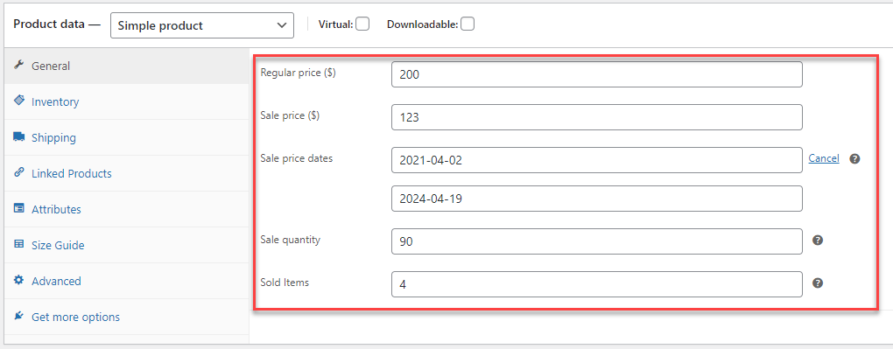
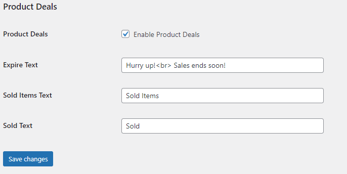

## Product Countdown

<a href="https://motta.uix.store/product/clic-marquetry-leather-case-for-iphone-11-pro/?product_sale_type=countdown">View Demo</a>

## Setup Product Countdown

1. Create a new product or edit a product.

2. Go to General tab and enter all settings below

## Disable Product Countdown

Go to **WooCommerce > Settings > Products > Product Deals** and uncheck Enable Product Deals option

## Change Product Countdown Texts

Go to **WooCommerce > Settings > Products > Product Deals** and change your texts

