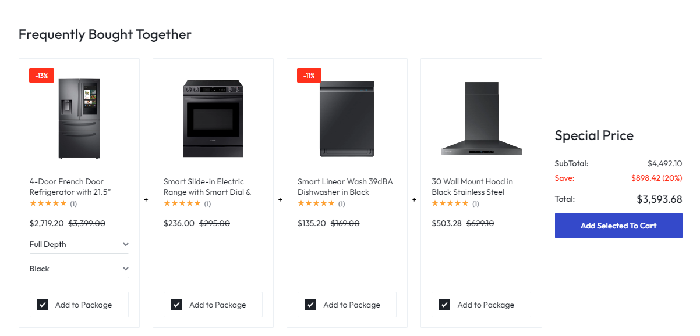
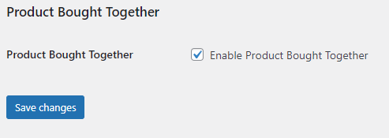
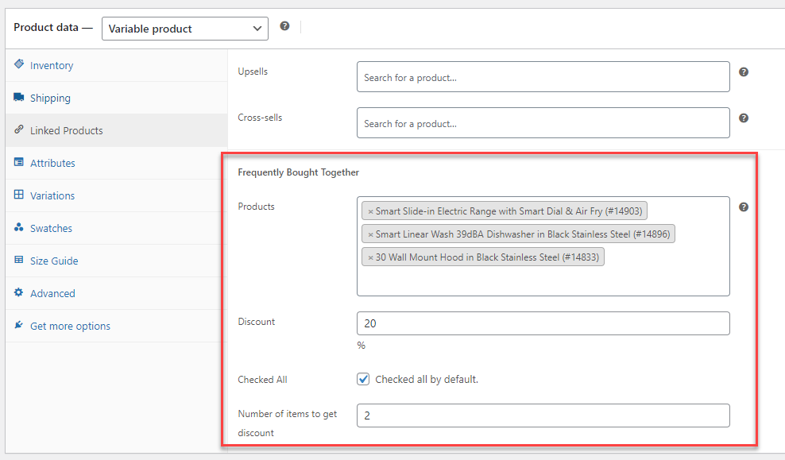

With Frequently Bought Together, your customers can buy related products with one single click, increasing the order value and your revenue.

<a href="https://motta.uix.store/product/4-door-french-door-refrigerator-with-21-5-touch-screen/">View Demo</a>

## Enable Frequently Bought Together

Just go to **WooCommerce > Settings > Products > Frequently Bought Together** to enable this feature

## Set Up Frequently Bought Together

In the **Product > Linked Products**, select the products you want.

