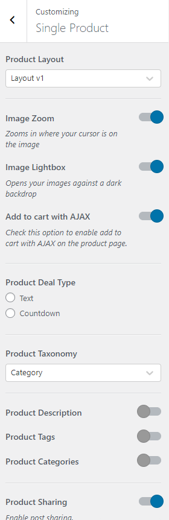

- **Product Layout** - select a product layout you want
- **Image Zoom** - turn on this option for zooming an image when you hover on it
- **Image Lightbox** - turn on this option for opening the gallery images in a lightbox when you click on an image
- **Add to cart with AJAX** - turn on this option for adding to cart without reloading the page
- **Product Deal Type** - To display a deal as text or countdown
- **Product Taxonomy** - To display a taxonomy ablow the product title: Category, Brand, None
- **Product Description** - To enable/disable the product description
- **Product Tags** - To enable/disable the product tags
- **Product Categories** - To enable/disable the product categories
- **Product Sharing** - To show social media sharing buttons
