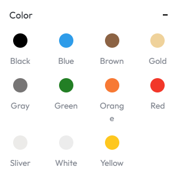
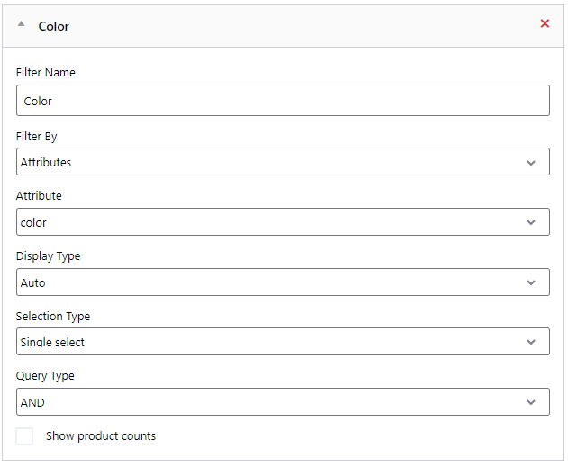
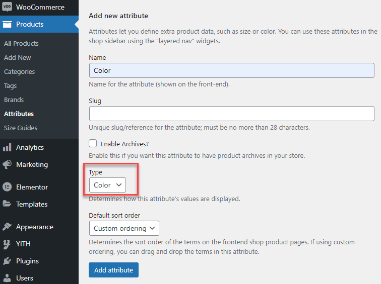
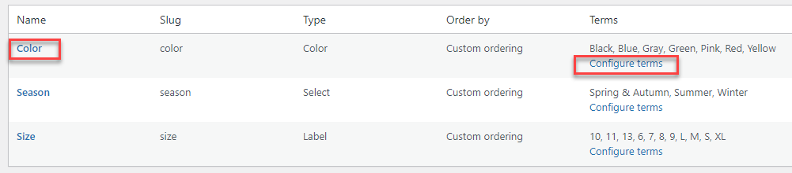
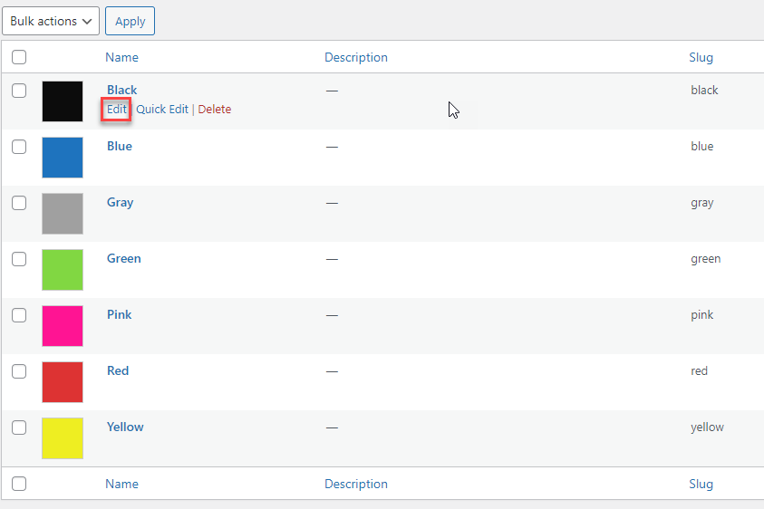
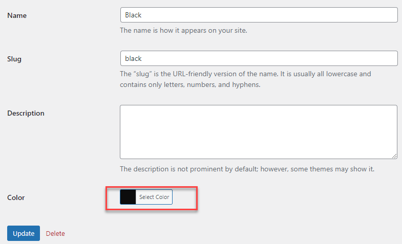

## Options

- **Filter By** - select Attributes
- **Attribute** - select Color
- **Display Type** - select Auto

## Setup Color Attribute

To setup color attribute, you need to follow the steps below:

1. Install and Activate **WCBoost – Variation Swatches** plugin
2. Go to **Products > Attributes** create a new atrribute and select Type is color

1. Go to **Products > Attributes > Color** click Configure terms

1. Hover an item and click edit

1. Select a color you want

