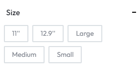
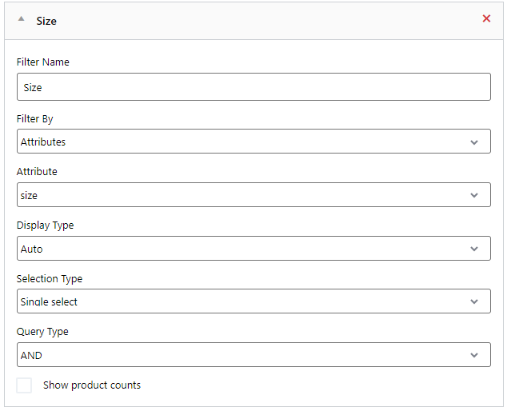
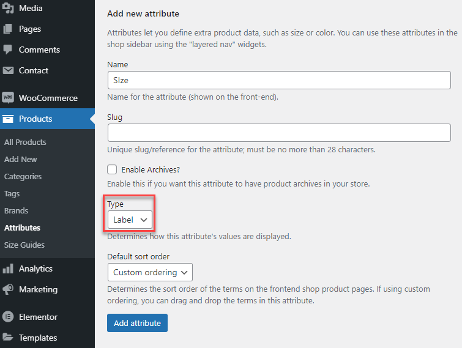

## Options

- **Filter By** - select Attributes
- **Attribute** - select Size
- **Display Type** - select Auto

## Setup Size Attribute

To setup size attribute, you need to follow the steps below:

1. Install and Activate **WooCommerce Variation Swatches Pro** plugin that is included in the theme
2. Go to **Products > Attributes** create a new atrribute and select Type is label

