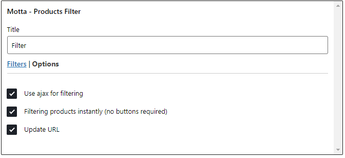

- **Use ajax for filtering** - turn on AJAX for filtering helps you avoid reloading the whole page when filtering
- **Filtering products instantly (no buttons required)** - turn on this option for filtering products instantly without clicking a filter button.
- **Update URL** - update URL to the browser without reloading the page
