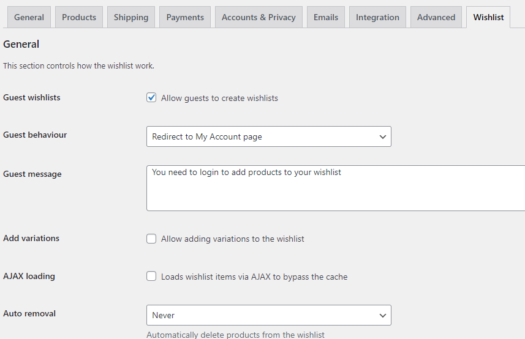

Motta theme come with WCBoots Wishlist plugin. After activated this plugin, you will new setting tab called **Wishlist** in **WooCommerce > Settings**. This tab contains options allow you to control the display of the wishlist.

