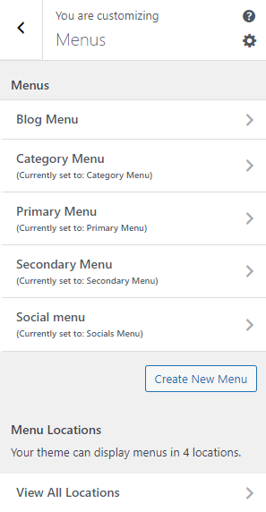

This is a default panel of WordPress. This panel is used for managing navigation menus for content you have already published on your site. You can create menus and add items for existing content such as pages, posts, categories, tags, formats, or custom links.

Menus can be displayed in [locations](../../header/menus/) defined the Motta theme or in widget areas by adding a "Custom Menu" widget.

You can see it is similar to the Menus screen in **Appearance > Menus**. Therefore, you can view the [Header > Menus](../../header/menus/) section for more detail. Just a note, configuring mega menu is not supported in this screen. You can do it only on **Appearance > Menus** page.
