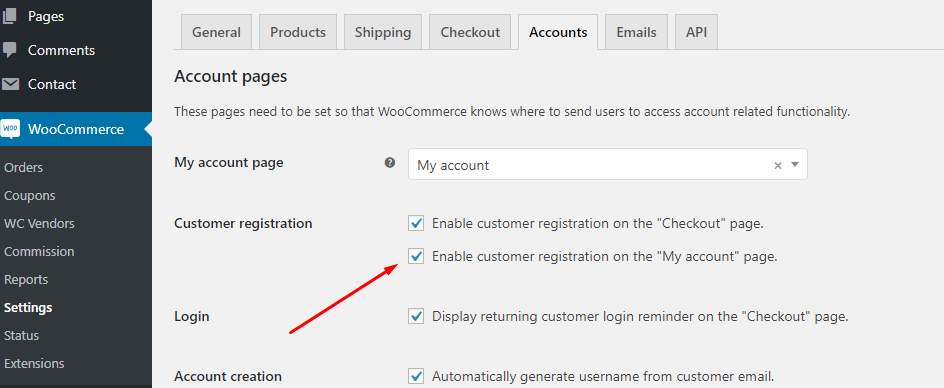
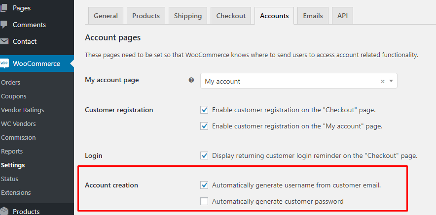
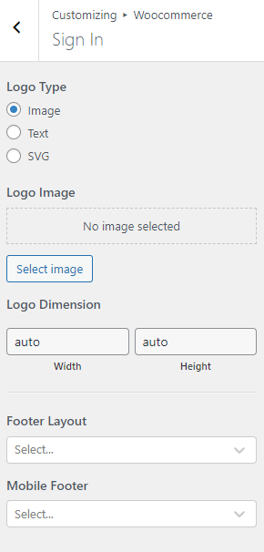

## Enable Register

By default, WooCommerce plugin disable register function. Just go to **WooCommerce > Settings > Accounts & Privacy > Customer registration** and check these options.

If you want to show username, password fields in the Register form, go to **WooCommerce > Settings > Accounts & Privacy and uncheck Automatically generate username from customer email, Automatically generate customer password** options.

## Log in with Social Accounts

To allow visitors to log in the shop with their social accounts (e.g. Facebook, Twitter), you can try to search on WordPress install the plugin below:

<https://wordpress.org/plugins/nextend-facebook-connect/>

## Log in Logo and Footer

To change the logo and footer of the Log in page, just go to **Appearance >** Customize > WooCommerce Sign In\*\*
